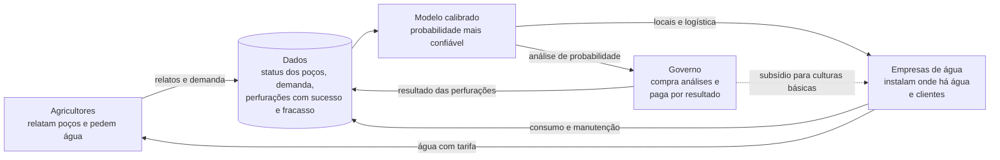

# Modelo de negócio do Wherewise

Como transformar o protótipo em um negócio viável com três clientes: **governos**, **empresas de
distribuição de água** e **agricultores**.

Os números deste documento saem do próprio modelo (v2, dados reais, parâmetros padrão) e dos pontos de
água do WPdx incluídos no projeto. Preços e percentuais de receita são **hipóteses para validar num
piloto**, e estão marcados assim.

---

## 1. A tese em uma frase

**Somos a camada de inteligência: não perfuramos, não operamos poços e não vendemos água. Vendemos a
probabilidade de encontrar água antes da perfuração, calculada a partir de dados.** Cada cliente paga
pelo que mais valoriza: **o governo paga para errar menos ao perfurar**, **a empresa de água paga para
saber onde instalar e onde estão os clientes**, e **o agricultor recebe a informação de graça** (a água
ele paga ao operador). Os dados que cada um devolve (perfurações bem-sucedidas e secas, poços que
pararam, demanda) melhoram o modelo, e o modelo calibrado é o ativo da empresa.

## 2. O que os números dizem

| Fato | Valor | Fonte |
|---|---|---|
| Custo de uma perfuração seca (40 m) | ~USD 4.000 + mobilização da sonda | Custos padrão do modelo: USD 1.200 fixos + USD 70/m |
| Chance média de sucesso do poço no país | 43% (mediana das células) | Modelo v2 |
| Perfurações necessárias por poço produtivo | 1 / `P_poço`: 3,3 com P = 30%, 2,2 com P = 45% | Probabilidade |
| Água para irrigar 5 ha | ~29 mil m³ por ano (só nos meses em que a chuva não basta) | Modelo v2 |
| Custo da água de poço, em 5 anos | **USD 0,14/m³** (mediana; 0,10 a 0,26 entre o 1º e o 3º quartil) | Modelo v2: investimento + energia |
| Custo da água de rio, em 5 anos | USD 0,50/m³ (mediana) | Modelo v2 |
| Custo por hectare irrigado | ~USD 820/ha por ano, a preço de custo | 5.860 m³/ha × USD 0,14 |
| Poços registrados que não funcionavam | **1.552 de 7.085 (22%)** | WPdx, levantamentos de 2014 a 2020 |

Três conclusões guiam o modelo de negócio:

1. **A análise de probabilidade vale muito para quem perfura em escala.** Subir a chance de sucesso de
   30% para 45% evita 1,1 perfuração seca por poço produtivo, ou ~USD 4.400 por poço.
2. **O agricultor pequeno não consegue pagar o custo cheio da água para culturas de subsistência.**
   USD 820/ha por ano passa da renda anual por pessoa na RDC (abaixo de USD 700). A água paga pelo
   agricultor só fecha a conta em **hortaliças e frutas com mercado perto**, como o cinturão verde de
   Kinshasa e das capitais de província. Para culturas básicas, alguém precisa subsidiar: governo ou
   doadores.
3. **Informação desatualizada custa caro.** Um em cada cinco poços registrados estava parado, e os
   dados têm de 6 a 12 anos. Saber **qual poço tem água hoje** é um produto em si.

## 3. Governos: venda da análise de probabilidade

**Para quem:** ministérios (Agricultura, Desenvolvimento Rural, Recursos Hídricos), o ONHR (Office
National de l'Hydraulique Rurale), governos provinciais e os programas de água financiados por bancos
de desenvolvimento e agências da ONU, que é de onde vem a maior parte do dinheiro de perfuração na RDC.

**O que vendemos:**

| Produto | Entrega | Cobrança (hipótese) |
|---|---|---|
| **Estudo provincial** | Mapa e relatório da província: onde perfurar, onde bombear do rio, onde não investir, com probabilidade, profundidade e custo | Preço fixo por província |
| **Triagem pré-licitação** | Para cada local de um programa: probabilidade de sucesso, profundidade esperada para orçar a licitação, alternativa por rio | Por local avaliado, como fração da economia esperada (ex.: 10–20% de ~USD 4.400 = USD 450–900 por local) |
| **Licença da plataforma** | Acesso ao app e à API para a equipe técnica do ministério, com os dados do próprio governo | Assinatura anual |
| **Pagamento por resultado** | Parte do preço só é paga quando o poço perfurado encontra água | Valor fixo menor + bônus por poço produtivo |

**Por que o pagamento por resultado é a porta de entrada:** o modelo ainda não está validado como
discriminante (AUC ~0,46 contra o WPdx, veja [VALIDACAO.md](prototipo/VALIDACAO.md)). Dividir o risco
com o cliente torna a venda possível agora. Além disso, o contrato obriga o envio do resultado de cada
perfuração, **com sucesso ou fracasso**, que é exatamente o dado que falta para calibrar o modelo.

## 4. Empresas de distribuição de água: parceria comercial

**Para quem:** empresas que perfuram e operam poços ou bombas de rio e vendem água para irrigação, seja
cobrando por m³, por hectare ou por temporada. Também cooperativas e ONGs que operam sistemas
comunitários.

**O modelo do parceiro:** a empresa investe no poço ou na captação e vende água aos agricultores ao
redor, cobrando uma tarifa. A tarifa paga a manutenção, e isso ataca o motivo de 22% dos poços estarem
parados: segundo a validação, o que faz um poço parar é sobretudo manutenção e gestão, não falta de água.

**O que nós entregamos (só análise; a perfuração, a operação e a cobrança são do parceiro):**

1. **Onde instalar:** locais com alta chance de água **e** com agricultores perto. É o modelo de hoje
   cruzado com a demanda (população do WorldPop, área agrícola do ESA WorldCover e cadastro de
   agricultores).
2. **Logística:** quantos poços e onde colocá-los para atender mais hectares por dólar investido;
   ordem de perfuração para a sonda percorrer menos estrada; poço ou rio em cada local.
3. **Demanda:** agricultores que pediram água pelo app ou pelo WhatsApp viram uma lista de clientes
   potenciais antes de a empresa investir.

**Como ganhamos (três formatos, do mais simples ao mais ambicioso):**

| Formato | Como funciona | Quando faz sentido |
|---|---|---|
| **Assinatura** | A empresa paga uma mensalidade pela plataforma e pela API (seleção de locais, logística, demanda) | Empresas que perfuram com frequência |
| **Análise por local** | A empresa paga por local avaliado antes de mobilizar a sonda | Empresas que perfuram pouco ou testam o serviço |
| **Parceria comercial** | Indicamos local e demanda; o parceiro perfura, opera e cobra a água; recebemos uma taxa por poço produtivo nos locais indicados | Projetos novos, em que o parceiro não teria local nem clientes sem nós |

**Exemplo ilustrativo (hipótese a validar):** cobrando 10–20% da economia esperada de ~USD 4.400 por poço
produtivo, a análise sai a USD 450–900 por local. Um parceiro que avalia 100 locais por ano gera
USD 45–90 mil por ano para nós.

**Cuidado com conflito de interesse:** se ganhamos uma taxa pelos poços de um parceiro, o governo pode
desconfiar das nossas recomendações. A análise vendida ao governo precisa ser **independente e com
método público** (o modelo e a validação já são abertos neste repositório), e o contrato com o parceiro
deve ser declarado.

## 5. Agricultores: onde há água agora

**O problema:** o agricultor não sabe qual poço perto dele tem água hoje. Um em cada cinco poços
registrados estava parado, e o levantamento mais recente do WPdx na RDC termina em 2020.

**O que entregamos:**

- **Ponto de água mais próximo funcionando:** distância, tipo (poço, chafariz, bomba de rio), situação
  e data da última confirmação.
- **Relatar a situação do poço:** "tem água", "seco", "quebrado", "fila grande". Uma mensagem pelo
  WhatsApp ou SMS basta, sem precisar de app nem de leitura avançada.
- **Pedir água a uma empresa parceira:** o pedido vira demanda para o parceiro (seção 4).
- **Orientação da temporada:** quando irrigar e quanto custa, pela IA, na língua do agricultor.

**Como ganhamos:** **o agricultor não paga pela informação.** Ele não tem como pagar, e cada agricultor
que usa e relata deixa o mapa melhor para todos. A água ele paga ao operador, não a nós. A receita vem
de forma indireta:

| Fonte | Como |
|---|---|
| Indicação de clientes | A empresa parceira paga por agricultor que vira cliente |
| Cooperativas | Assinatura de baixo custo para planejar a temporada do grupo |
| Dados agregados | O status dos poços, agregado e sem identificar ninguém, alimenta o produto do governo (monitoramento de programas) |

**Incentivo para relatar:** quem confirma a situação de um poço ganha crédito ou desconto na água. Os
dados pessoais (telefone, localização) ficam protegidos e só saem da plataforma de forma agregada.

## 6. Como os três se conectam

O governo e os doadores podem **subsidiar a água para culturas básicas pagando a empresa por hectare
irrigado ou por agricultor atendido**. Assim o agricultor pequeno é atendido sem pagar o custo cheio,
e a empresa tem receita garantida.

## 7. Resumo da receita

| Cliente | Paga por | Formato | Quando a receita começa |
|---|---|---|---|
| Governo e programas financiados | Análise de probabilidade, estudos provinciais, licença | Contrato fixo + bônus por poço produtivo | Primeiro piloto |
| Empresas de água | Seleção de locais, logística e demanda | Assinatura, análise por local ou taxa por poço produtivo indicado | Primeiro contrato com uma empresa de perfuração |
| Agricultores | Nada a nós: a informação é gratuita, e a água é paga ao operador | Geram dados (relatos) e demanda, que viram receita com governo e empresas | Junto com as empresas de água |
| Cooperativas | Planejamento da temporada | Assinatura baixa | Depois do piloto |

## 8. Riscos

| Risco | Como reduzir |
|---|---|
| O modelo não está validado | Vender com piloto e pagamento por resultado; exigir em contrato os registros de perfuração com sucesso e fracasso |
| O agricultor não consegue pagar | Começar por hortaliças e frutas perto de mercados; subsídio por hectare para culturas básicas; pagamento por uso, depois da colheita |
| Direito de captar água | A Lei da Água da RDC (2015) trata a água como bem público e exige autorização para captação. Nós não captamos: a autorização é do parceiro que perfura e opera. Validar com advogado local |
| Atraso no pagamento do governo | Priorizar contratos financiados por bancos de desenvolvimento e agências da ONU |
| Dados desatualizados | Relatos dos agricultores, dados de consumo dos parceiros e, depois, medidores de vazão (IoT) nos poços |
| Conflito de interesse com o parceiro | Análise para o governo independente e com método público; contratos declarados |
| Privacidade dos agricultores | Coletar o mínimo, guardar protegido, vender só dados agregados |

## 9. O que construir para começar a cobrar

O protótipo já calcula probabilidade, profundidade e custo por local, compara poço e rio, mostra os
pontos do WPdx com a situação de cada um e explica tudo com IA. Para cobrar, faltam:

| Para | O que falta |
|---|---|
| **Governo** | Relatório em PDF por província e por lista de locais; contas de usuário; envio dos registros de perfuração do cliente; usar o modelo v2 como padrão e calibrá-lo com esses registros |
| **Empresas de água** | Cadastro de agricultores e mapa de demanda; otimização de onde instalar N poços; relatório de locais priorizados por chance de água e demanda |
| **Agricultores** | Rota "ponto de água mais próximo funcionando" na API; rota para relatar a situação de um poço; canal WhatsApp ou SMS; funcionamento offline com sincronização |
| **Plataforma** | Autenticação e limite de uso na API (hoje qualquer pessoa pode chamar o `/api/chat`), registro de auditoria e termos de privacidade |

## 10. Próximo passo: piloto de dados

Não perfuramos. O piloto mede o modelo com **perfurações que já aconteceram**, em 90 dias:

1. **Reunir os registros de perfuração**, com sucesso **e** com poço seco, do Ministério, do ONHR, da
   REGIDESO, de ONGs e de empresas de perfuração que atuaram na província.
2. **Medir o acerto:** comparar a probabilidade que o modelo dá a cada local com o que a perfuração
   encontrou, antes de qualquer perfuração nova.
3. **Calibrar o modelo** com esses registros (a seção 3.9 do plano prevê Random Forest/XGBoost quando
   houver dados de campo).
4. **Entregar** o mapa calibrado da província e a taxa de acerto medida.

A sugestão é **Kinshasa**: tem o maior mercado de hortaliças do país, concentra órgãos de governo e
empresas de perfuração (e os registros delas) e é uma das regiões com mais pontos do WPdx para comparar.

O que medir no piloto:

- taxa de acerto do modelo nas perfurações históricas (AUC e a taxa de sucesso entre os locais com maior
  probabilidade, comparada com a média);
- quanto a calibração com os registros melhora essa taxa.

O que medir depois, quando os clientes perfurarem nos locais indicados (dados que eles devolvem):

- taxa de perfurações secas nos locais recomendados, comparada com o histórico da região;
- custo por poço produtivo;
- poços funcionando 12 meses depois.
